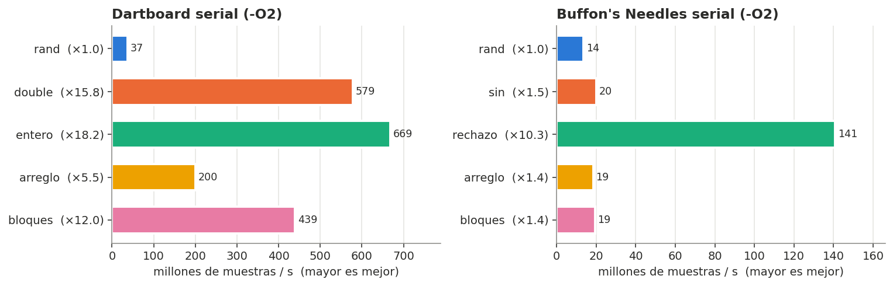
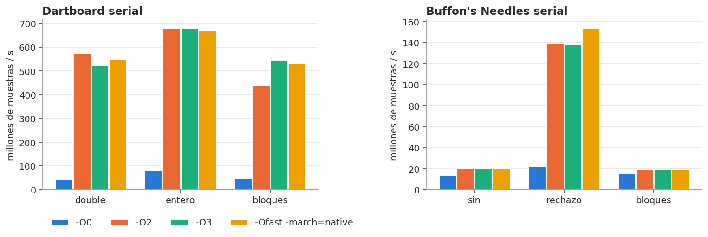
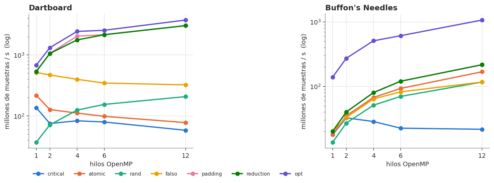
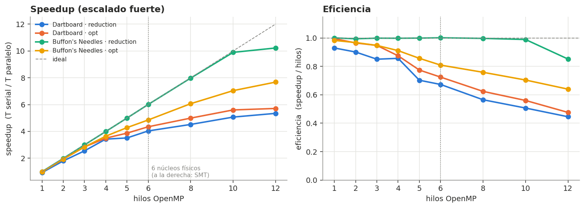
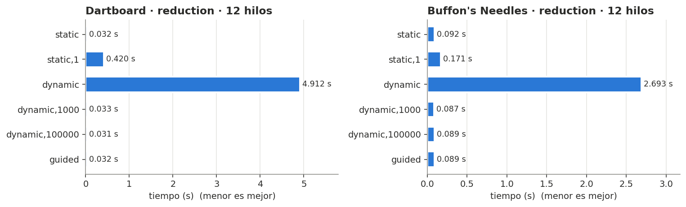
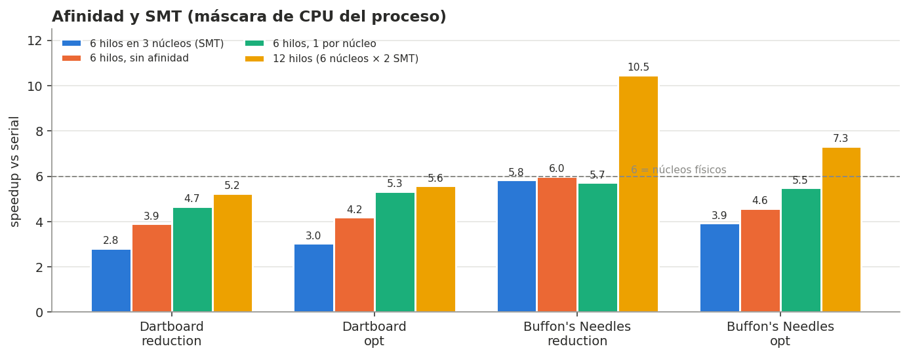
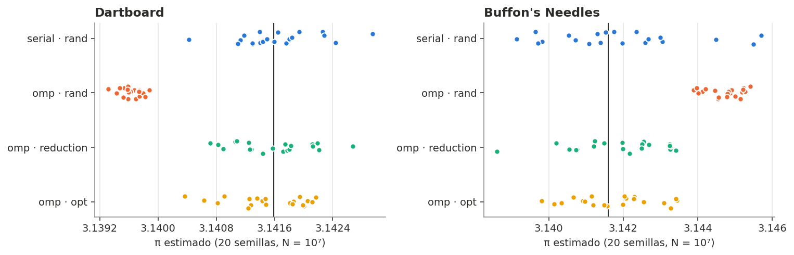
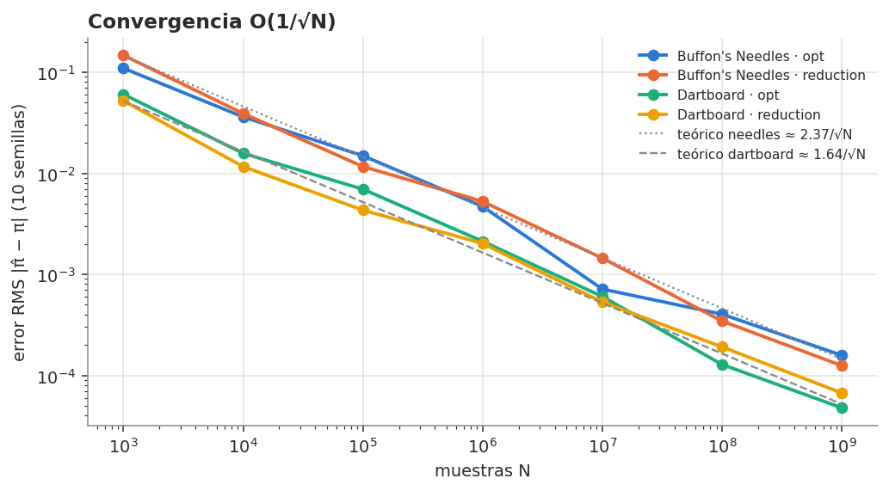

# Reto 2 — Cálculo de π por Monte Carlo con OpenMP

Proyecto HPC 2026-2 · Rama `reto2`

Implementación serial y paralela (OpenMP) de dos métodos de Monte Carlo para estimar π
—**Dartboard** (tablero de dardos) y **Buffon's Needles** (agujas de Buffon)—, con
benchmarks, perfilado de CPU y memoria, optimizaciones de CPU y memoria y el análisis de
las causas del desempeño medido.

| Requisito del reto | Dónde está |
|---|---|
| 1. Análisis de los algoritmos | [§2](#2-análisis-de-los-algoritmos) |
| 2. Versiones seriales | [`src/dartboard_serial.c`](src/dartboard_serial.c), [`src/needles_serial.c`](src/needles_serial.c) · [§3](#3-versiones-seriales-y-optimización-de-cpu-y-memoria) |
| 3. Opciones de paralelización con OpenMP y optimización de CPU/memoria | [`src/dartboard_omp.c`](src/dartboard_omp.c), [`src/needles_omp.c`](src/needles_omp.c) · [§3](#3-versiones-seriales-y-optimización-de-cpu-y-memoria) y [§4](#4-paralelización-con-openmp) |
| 4. Causas de los resultados de desempeño | [§5](#5-causas-del-desempeño) |

---

## 1. Estructura, compilación y reproducción

```
reto2/
├── src/
│   ├── comun.h              # reloj QPC, generador xoshiro256** (+ salto 2^128), CLI, salida CSV
│   ├── nucleos.h            # nucleo de UNA muestra de cada metodo (compartido serial/OpenMP)
│   ├── dartboard_serial.c   # 5 variantes seriales
│   ├── needles_serial.c     # 5 variantes seriales
│   ├── dartboard_omp.c      # 7 estrategias OpenMP
│   └── needles_omp.c        # 7 estrategias OpenMP
├── scripts/
│   ├── benchmark.sh         # experimentos E1..E9  -> datos/*.csv
│   ├── perfilado.sh         # perfil.exe (CPU/memoria) + gprof -> datos/perfilado.csv, perfilado/
│   └── graficas.py          # graficas/*.png y graficas/tabla_*.csv
├── datos/                   # mediciones crudas (separador ';' y coma decimal)
├── perfilado/               # salidas de gprof y datos del equipo
├── graficas/                # figuras y tablas resumen (medianas)
└── Makefile
```

```bash
cd reto2
mingw32-make                    # compila las 15 variantes de binarios en bin/
bash scripts/benchmark.sh       # ~15 min; o solo algunos: bash scripts/benchmark.sh E3 E9
bash scripts/perfilado.sh       # ~2 min
python scripts/graficas.py
```

Todos los programas comparten la interfaz:

```
bin/dartboard_omp -n 1e9 -t 12 -v opt -s 42 [-c]
  -n muestras · -t hilos · -v variante · -s semilla · -c una línea CSV
```

**Equipo de medición** ([`perfilado/equipo.txt`](perfilado/equipo.txt)): AMD Ryzen 5 5600G
(6 núcleos / 12 hilos SMT, L2 512 KiB/núcleo, L3 16 MiB compartida), 32 GiB RAM,
Windows 10 Pro, GCC 13.1 (MSYS2 UCRT64). Cada tiempo es la **mediana de 5 repeticiones**
(cronómetro QPC; `omp_get_wtime()` en MinGW solo resuelve ~1 ms).

---

## 2. Análisis de los algoritmos

### 2.1 Dartboard

Se lanzan *N* dardos uniformes sobre el cuadrado [0,1)². La probabilidad de caer dentro del
cuarto de círculo x² + y² ≤ 1 es su área, **π/4**:

```
p = π/4      ⇒      π̂ = 4 · (dentro / N)
```

- **Coste por muestra:** 2 números aleatorios + 2 multiplicaciones + 1 suma + 1 comparación.
  Es un núcleo diminuto (~1,5 ns): **el generador aleatorio es el cuello de botella**.
- **Error estadístico:** el conteo es binomial, así que σ(π̂) = 4·√(p(1−p)/N) ≈ **1,64/√N**.
- **Memoria:** O(1). No hace falta guardar los dardos.

### 2.2 Buffon's Needles

Se dejan caer agujas de longitud *l* sobre un piso con líneas paralelas separadas *t*
(aguja corta, l ≤ t). Sea *x* ~ U[0, t/2] la distancia del centro de la aguja a la línea más
cercana y θ ~ U[0, π/2] su ángulo. La aguja cruza una línea si **x ≤ (l/2)·sen θ**, y

```
P(cruce) = 2l / (tπ)       con l = 1, t = 2:   P = 1/π   ⇒   π̂ = N / cruces
```

- **Coste por muestra:** 2 aleatorios + **sen θ**. En MinGW-w64, `sin()` es
  `__sinl_internal` (x87, `long double`) y cuesta ~50 ns (~200 ciclos), unas 30 veces más
  que un dardo.
- **Error:** por el método delta, σ(π̂) ≈ π²·√(q(1−q)/N) con q = 1/π, es decir,
  **≈ 2,37/√N**. Para la misma precisión necesita (2,37/1,64)² ≈ **2,1 veces más
  muestras** que Dartboard.
- **Circularidad:** muestrear θ ~ U[0, π/2] *usa* π para calcular π. La variante optimizada
  (`rechazo`) evita π, `sin()` y `sqrt()` (ver §3.2).

### 2.3 Propiedades comunes que importan para el paralelismo

| Propiedad | Consecuencia |
|---|---|
| Las muestras son **independientes** | Problema vergonzosamente paralelo: no hay dependencias entre iteraciones |
| El resultado es una **suma** (conteo) | Se paraleliza con una **reducción**: un contador privado por hilo y una suma al final |
| Todas las iteraciones **cuestan lo mismo** | Un reparto `static` equilibra la carga sin coste de planificación |
| Uso de memoria **O(1)** | Limitado por cómputo; la memoria solo importa si se introduce mal (arreglos, contadores compartidos) |
| Depende de un **generador pseudoaleatorio** | Es el único estado compartido "oculto": cada hilo necesita un flujo propio, independiente y que no se solape |
| Error **O(1/√N)** | Cada dígito decimal extra cuesta ×100 muestras: el paralelismo compra precisión, no la regala |

---

## 3. Versiones seriales y optimización de CPU y memoria

Todas las variantes usan el mismo N y la misma semilla ([`graficas/tabla_serial.csv`](graficas/tabla_serial.csv), `-O2`):



| Algoritmo | Variante | Qué hace | ns/muestra | vs `rand` |
|---|---|---|---:|---:|
| Dartboard | `rand` | Versión de libro: libc `rand()` | 27,3 | 1× |
| | `double` | xoshiro256**, 2 doubles por dardo (**referencia**) | 1,73 | 15,8× |
| | **`entero`** | **1 aleatorio de 64 bits → 2 coordenadas de 31 bits, comparación entera** | **1,50** | **18,2×** |
| | `arreglo` | Genera los N puntos en arreglos y luego cuenta | 5,00 | 5,5× |
| | `bloques` | Buffer de 1024 puntos (16 KiB, cabe en L1) + bucle de conteo vectorizable | 2,28 | 12,0× |
| Needles | `rand` | libc `rand()` + `sin()` | 73,3 | 1× |
| | `sin` | xoshiro256** + `sin()` (**referencia**) | 49,9 | 1,5× |
| | **`rechazo`** | **ángulo por rechazo, sin `sin`/`sqrt`/π** | **7,10** | **10,3×** |
| | `arreglo` | Genera los N pares en arreglos y luego cuenta | 53,9 | 1,4× |
| | `bloques` | Buffer de 1024 pares + bucle de conteo | 51,7 | 1,4× |

### 3.1 Optimización de CPU: el generador

`rand()` es la peor elección posible en este problema:

- Es una llamada a una DLL (`ucrtbase.dll`): no se puede inlinear ni vectorizar. gprof, que
  no muestrea dentro de las DLL, solo ve 0,81 s de los 2,75 s de ejecución: **~70 % del
  tiempo está dentro de `rand()`**.
- `RAND_MAX = 32767` en Windows: solo 15 bits. El "tablero" queda discretizado en una
  rejilla de 32768², lo que introduce un sesgo sistemático.
- Su estado está oculto, así que no sirve para dar flujos reproducibles e independientes a
  cada hilo (§4.1, variante `rand`).

**xoshiro256\*\*** (Blackman y Vigna) son ~10 operaciones enteras sin divisiones, con un
estado de 32 bytes que vive en registros, y tiene una función de **salto de 2^128** que da a
cada hilo un subflujo garantizado sin solapamiento. Por sí solo da **×15,8** en Dartboard.

### 3.2 Optimización de CPU: el núcleo

- **Dartboard `entero`:** un solo `uint64` aporta x (31 bits altos) e y (31 bits bajos);
  x² + y² < 2^63 no desborda, y la prueba es `x²+y² < 2^62`. Se hace **la mitad de llamadas
  al generador** y no hay conversiones entero→double: **+15 %** sobre `double`. Aun así
  sigue limitado por el generador; gprof atribuye ~69 % del tiempo de `double` a
  `xo_siguiente`/`xo_double`/`rotl64`.
- **Needles `rechazo`:** se toma un vector (u, v) uniforme en el cuarto de círculo
  (rechazando los de fuera); su dirección es uniforme en [0, π/2] y
  sen θ = v / √(u² + v²). Elevando al cuadrado la condición (todo es ≥ 0):

  ```
  x ≤ ½ · v/√(u²+v²)    ⇔    x² · (u²+v²) ≤ ¼ · v²
  ```

  No usa `sin`, `sqrt` ni π, y consume en promedio 4/π ≈ 1,27 pares por aguja.
  Resultado: **×7 frente a `sin`**. gprof confirma que en `sin` el 86 % del tiempo útil se
  va en `__sinl_internal` + `sin`
  ([`perfilado/gprof_needles_sin.txt`](perfilado/gprof_needles_sin.txt)).

### 3.3 Optimización de memoria

| Variante | Memoria pico | Fallos de página | CPU de kernel | Fuente |
|---|---:|---:|---:|---|
| Dartboard `double` (N=10⁸) | 0,74 MiB | 1 183 | 0,00 s | [`tabla_perfilado.csv`](graficas/tabla_perfilado.csv) |
| Dartboard `arreglo` (N=10⁸) | **1 529 MiB** | **392 572** | **0,22 s** (46 % del total) | |
| Needles `arreglo` (N=2·10⁷) | 306 MiB | 79 461 | 0,03 s | |

- **`arreglo`** convierte un problema O(1) en memoria en uno O(N): 16 B escritos y 16 B
  leídos por muestra, más **un fallo de página por cada 4 KiB** la primera vez que se toca
  cada página (392 572 ≈ 1,6 GB / 4 KiB). Casi la mitad del tiempo es **kernel** (Windows
  pone a cero páginas nuevas). Dartboard se vuelve **2,9× más lento**. En Needles solo
  pierde un 8 %, porque `sin()` tapa el coste de memoria. Además, `arreglo` impone un
  límite de N por la RAM disponible: es la *anti-optimización* de referencia.
- **`bloques`** (*strip-mining*): el buffer de 16 KiB vive en L1, así que no hay tráfico a
  RAM ni fallos de página y el bucle de conteo queda libre de dependencias y es
  vectorizable. **Pero no supera al streaming** (2,28 frente a 1,73 ns con `-O2`; con
  `-O3` empata), porque el cuello de botella es la cadena de dependencias del generador,
  no la comparación. En Needles tampoco ayuda: en Windows no hay `libmvec`, así que `sin()`
  no se vectoriza aunque el bucle esté preparado.
- **Conclusión de memoria:** para Monte Carlo, la mejor "optimización de memoria" es
  **no usar memoria**. Hay que generar y consumir cada muestra en registros (streaming),
  con O(1) bytes por hilo y O(p) en total.

### 3.4 Optimización por compilador



- **`-O0` → `-O2`: ×13 a ×14** en Dartboard. Con `-O0`, cada `xo_siguiente`/`rotl64` es una
  llamada real y el estado de 32 bytes va y viene de la pila en cada muestra; con `-O2` se
  inlinea todo y el estado vive en registros.
- **`-O3` y `-Ofast -march=native` no aportan nada de forma consistente** (±10 %). No hay
  bucles vectorizables significativos, porque el generador es secuencial por naturaleza.
  La única ganancia clara es `rechazo` con `-Ofast -march=native` (+11 %, por FMA).
- En `sin` las banderas no cambian nada: el tiempo está en una función de biblioteca
  compilada aparte.

---

## 4. Paralelización con OpenMP

### 4.1 Opciones analizadas

Lo único que comparten los hilos es **el contador** y **el generador**. Se implementaron 7
estrategias, de peor a mejor:

| Variante | Contador | Generador | Problema que ilustra |
|---|---|---|---|
| `critical` | compartido, `#pragma omp critical` en cada acierto | privado | Serialización: un candado global (mutex del SO) |
| `atomic` | compartido, `#pragma omp atomic` | privado | *Contention*: la línea de caché del contador rebota entre núcleos (MESI) |
| `rand` | `reduction(+)` | libc `rand()` | Generador inadecuado: estado oculto, mala calidad |
| `falso` | `contadores[id]` contiguos (`volatile`) | `estados[id]` contiguos | **False sharing**: 8 contadores en la misma línea de 64 B |
| `padding` | ranura por hilo `_Alignas(64)` (`volatile`) | en la ranura | Corrige el false sharing con relleno |
| **`reduction`** | **privado + `reduction(+:dentro)`** | **local (registros) + salto 2^128** | Forma idiomática: una sincronización por hilo |
| **`opt`** | igual que `reduction` | igual | + núcleo optimizado (`entero` / `rechazo`) |

Esqueleto de la versión recomendada:

```c
long long dentro = 0;
#pragma omp parallel reduction(+:dentro)
{
    xoshiro_t r;                                    /* estado LOCAL: vive en registros  */
    xo_semilla_hilo(&r, semilla, omp_get_thread_num());  /* semilla + id·2^128     */
    #pragma omp for schedule(runtime)               /* static por defecto            */
    for (long long i = 0; i < n; i++)
        dentro += dardo_entero(&r);
}
return 4.0 * dentro / n;
```

Decisiones de diseño:

- **`parallel` + `for` separados** (en lugar de `parallel for`) para poder inicializar el
  generador de cada hilo una sola vez, fuera del bucle.
- **Saltos de 2^128**: los flujos de los hilos no se solapan y el resultado es
  **reproducible** para un número de hilos dado con `schedule(static)`.
- **`schedule(runtime)`** con `static` por defecto, para comparar repartos con
  `OMP_SCHEDULE` sin recompilar (§4.4).
- **Sobre `volatile` en `falso`/`padding`:** con `-O2`, GCC hace *store motion* y mantiene
  `contadores[id]` en un registro durante todo el bloque, lo que **elimina el false
  sharing** (se comprobó en el ensamblador con `gcc -S`: en la versión inicial `falso` y
  `padding` medían lo mismo). `volatile` reproduce lo que pasa en código real cuando el
  compilador no puede probar que no hay alias. Las dos variantes lo llevan, así que solo
  cambia la disposición en memoria.

### 4.2 Las 7 estrategias frente al número de hilos



Tiempos en segundos (Dartboard N=10⁸, Needles N=2·10⁷; [`tabla_variantes_omp.csv`](graficas/tabla_variantes_omp.csv)):

| Variante | Dartboard 1 h | Dartboard 12 h | | Needles 1 h | Needles 12 h |
|---|---:|---:|---|---:|---:|
| `critical` | 0,734 | **1,724** ↑ | | 1,125 | 0,927 |
| `atomic` | 0,461 | **1,289** ↑ | | 1,121 | 0,119 |
| `rand` | 2,704 | 0,483 | | 1,470 | 0,172 |
| `falso` | 0,194 | **0,310** ↑ | | 0,991 | 0,171 |
| `padding` | 0,185 | 0,033 | | 0,997 | 0,093 |
| `reduction` | 0,187 | 0,033 | | 0,996 | 0,092 |
| `opt` | **0,147** | **0,027** | | **0,144** | **0,019** |

↑ = **más lento con 12 hilos que con 1**.

Perfil de CPU con 12 hilos ([`tabla_perfilado.csv`](graficas/tabla_perfilado.csv)):

| Dartboard, 12 hilos | Pared | CPU usuario | CPU kernel | Núcleos ocupados |
|---|---:|---:|---:|---:|
| `critical` | 1,78 s | 1,64 s | **4,06 s** | 3,2 |
| `atomic` | 1,30 s | **14,5 s** | 0,02 s | 11,2 |
| `falso` | 0,36 s | 3,20 s | 0,00 s | 9,1 |
| `padding` | 0,046 s | 0,28 s | 0,02 s | 6,4 |
| `reduction` | 0,046 s | 0,38 s | 0,02 s | 8,6 |

### 4.3 Escalado fuerte de las versiones buenas



Speedup = T(serial, mismo núcleo) / T(OpenMP) ([`tabla_speedup.csv`](graficas/tabla_speedup.csv)):

| Hilos | Dartboard `reduction` | Dartboard `opt` | Needles `reduction` | Needles `opt` |
|---:|---:|---:|---:|---:|
| 1 | 0,93 | 1,00 | 1,00 | 0,98 |
| 2 | 1,80 | 1,93 | 1,99 | 1,94 |
| 4 | 3,43 | 3,50 | 3,99 | 3,64 |
| 6 | 4,04 | 4,35 | **6,01** | 4,85 |
| 8 | 4,52 | 4,99 | 7,98 | 6,07 |
| 12 | 5,35 | 5,71 | **10,22** | 7,68 |

### 4.4 Política de reparto (`schedule`)



| `OMP_SCHEDULE` | Dartboard | Needles | Motivo |
|---|---:|---:|---|
| `static` | 0,032 s | 0,092 s | Bloques contiguos, cero coordinación |
| `static,1` | 0,420 s (×13) | 0,171 s | Con `schedule(runtime)`, libgomp hace una llamada a `GOMP_loop_*_next` por bloque: 10⁸ llamadas |
| `dynamic` (bloque 1) | **4,912 s (×150)** | 2,693 s | Cada iteración hace un *fetch-and-add* atómico sobre el contador compartido de iteraciones: contention extrema |
| `dynamic,1000` | 0,033 s | 0,087 s | El coste de coordinación se amortiza |
| `dynamic,100000` | 0,031 s | 0,089 s | |
| `guided` | 0,032 s | 0,089 s | |

Como la carga es uniforme, `static` es óptimo, y además es el único que da resultados
**reproducibles** (con `dynamic`, el bloque que toca a cada hilo, y por tanto a cada flujo
aleatorio, cambia en cada ejecución). `dynamic` con bloques grandes solo sirve para
compensar hilos que el SO frena (§5.3).

### 4.5 Afinidad e hilos SMT

libgomp de MinGW **no implementa afinidad**: `OMP_PLACES`/`OMP_PROC_BIND` se ignoran y
muestra el aviso `libgomp: Affinity not supported on this configuration`. Por eso se fijó la
máscara de CPU **del proceso** con `cmd /c start /affinity <hex>` (experimento E9). En el
5600G, los CPU lógicos 2k y 2k+1 son hermanos SMT del mismo núcleo físico.



| Configuración | Dartboard `opt` | Needles `reduction` (sin) | Needles `opt` |
|---|---:|---:|---:|
| 6 hilos en 3 núcleos × 2 SMT (`03F`) | 3,0× | **5,8×** | 3,9× |
| 6 hilos, sin afinidad (`FFF`) | 4,2× | 6,0× | 4,6× |
| 6 hilos, 1 por núcleo físico (`555`) | **5,3×** | 5,7× | **5,5×** |
| 12 hilos (`FFF`) | 5,6× | **10,5×** | 7,3× |

### 4.6 Calidad del resultado y convergencia



| 20 semillas, N=10⁷ | Media π̂ | Desv. entre semillas | Sesgo | RMSE |
|---|---:|---:|---:|---:|
| Dartboard serial `rand` | 3,1416 | 0,0006 | 0,0000 | 0,0005 |
| Dartboard **OpenMP `rand`** | **3,1396** | **0,0001** | **−0,0020** | **0,0020** |
| Dartboard OpenMP `reduction` | 3,1416 | 0,0005 | 0,0000 | 0,0005 |
| Needles **OpenMP `rand`** | **3,1447** | 0,0005 | **+0,0031** | **0,0032** |
| Needles OpenMP `reduction` | 3,1419 | 0,0013 | +0,0003 | 0,0013 |



El error RMS sigue las curvas teóricas **1,64/√N** (Dartboard) y **2,37/√N** (Needles) de
N = 10³ a 10⁹. Con 10⁹ muestras se obtienen ~4-5 cifras correctas.

### 4.7 Resultado final

Mejor combinación: `opt` + `-Ofast -march=native` + 12 hilos ([`tabla_mejor.csv`](graficas/tabla_mejor.csv)):

| | Línea base (serial `rand`, `-O2`) | Mejor | Mejora total |
|---|---:|---:|---:|
| Dartboard, 10⁹ dardos | 27,3 s (estimado: 27,3 ns × 10⁹) | **0,251 s** (3,98·10⁹ dardos/s) | **×109** |
| Needles, 5·10⁸ agujas | 36,6 s (estimado: 73,3 ns × 5·10⁸) | **0,401 s** (1,25·10⁹ agujas/s) | **×91** |

De ese ×109 de Dartboard, ×18 viene del algoritmo y el generador (serial) y ×6 del
paralelismo. **La optimización serial pesó más que los 12 hilos.**

---

## 5. Causas del desempeño

### 5.1 Por qué `critical` y `atomic` son más lentos con más hilos

- **`critical`**: cada acierto (78,5 % de los dardos) adquiere el candado global. En MinGW,
  libgomp lo implementa con un mutex del SO: cuando hay contención, el hilo **duerme en el
  kernel**. Por eso hay 4,06 s de CPU de *kernel* frente a 1,64 s de usuario, y solo 3,2
  núcleos ocupados en promedio. La sección crítica serializa todo el programa (fracción
  serial ≈ 1 en la ley de Amdahl) y le suma el coste de los cambios de contexto.
- **`atomic`**: no duerme (`lock xadd`, todo en usuario), pero la línea de 64 B del contador
  tiene que pasar en exclusiva (estado *Modified* de MESI) al núcleo que incrementa. Con 12
  hilos, la línea viaja de L1 a L1 cientos de millones de veces. Resultado: **11,2 núcleos
  al 100 % durante 1,3 s para hacer el trabajo que 1 núcleo hace en 0,19 s** (14,5 s de CPU,
  ~75 veces más trabajo de CPU).
- **En Needles el daño es menor** porque la tasa de escritura al contador es mucho más baja:
  un acierto cada ~150 ns (50 ns por muestra / P = 1/π) frente a uno cada ~2 ns en Dartboard.
  `atomic` escala casi como `reduction` (0,119 frente a 0,092 s). **La contención es
  proporcional a la frecuencia de acceso al dato compartido, no a que exista.** `critical`
  sigue siendo malo porque el coste fijo del mutex (~100 ns+) es comparable al de una
  aguja.

### 5.2 False sharing

`falso` y `padding` ejecutan **exactamente las mismas instrucciones**. Solo cambia la
dirección de cada contador: en `falso`, 8 contadores de 8 B comparten una línea de 64 B.
Cada escritura de un hilo invalida la copia de la línea en los otros 7 núcleos, aunque
nunca lean el dato del vecino. El protocolo de coherencia trabaja por **líneas**, no por
variables. Medido:

- Dartboard con 12 hilos: **0,310 s frente a 0,033 s (×9,4)**, y `falso` es **más lento que
  con 1 hilo**. CPU de usuario: 3,2 s frente a 0,28 s.
- Needles: 0,171 frente a 0,093 s (×1,8), menor por la misma razón que `atomic` (menos
  escrituras por segundo).

`padding` (`_Alignas(64)`, una ranura por línea) iguala a `reduction`. La versión idiomática
(`reduction` con estado local) ni siquiera necesita relleno: el contador y el generador
viven en **registros**, así que no generan tráfico de coherencia.

### 5.3 Por qué Dartboard escala peor que Needles (5,4× frente a 10,2× con 12 hilos)

Con datos de E3 y E9 se identifican tres causas, en orden de peso:

1. **Planificación de Windows sin afinidad + reparto `static`.** Sin afinidad, Windows a
   veces coloca 2 de los 6 hilos en los dos SMT de un mismo núcleo. Esos hilos avanzan a la
   mitad de velocidad y, con `static`, **todos esperan al más lento**. Prueba directa:
   fijando un hilo por núcleo físico (`555`), Dartboard `opt` pasa de **4,2× a 5,3×** con 6
   hilos. Con 6 hilos y sin afinidad, la CPU de usuario por hilo (2,48 s / 6 = 0,41 s) es
   claramente menor que el tiempo de pared (0,46 s): hay hilos esperando en la barrera
   implícita. Un `dynamic` de bloque grande también lo compensa parcialmente (en una prueba
   puntual con `dynamic,1000000`: 0,32 s frente a 0,35 s con `static`).
2. **SMT sirve según el núcleo.** El generador xoshiro y la comparación entera tienen mucho
   **paralelismo a nivel de instrucción**: un solo hilo ya satura las ALU del núcleo, y el
   hermano SMT apenas encuentra puertos libres. 6 hilos en 3 núcleos (`03F`) rinden solo
   3,0×, y pasar de 6 a 12 hilos añade ~5-15 %. En cambio, `__sinl_internal` es código x87
   con largas **cadenas de dependencia** (latencia, no throughput): un hilo deja unidades
   ociosas que el hermano SMT llena. Por eso 6 hilos en 3 núcleos rinden **igual** que en 6
   núcleos (5,8× frente a 5,7×), y 12 hilos dan **10,5×** con 6 núcleos físicos.
   `rechazo` queda en medio: su bucle de rechazo tiene un salto difícil de predecir (21 %
   de rechazos), y los fallos de predicción dejan huecos que SMT aprovecha en parte (5,5× →
   7,3×).
3. **Frecuencia y núcleo OpenMP.** Con un hilo, el 5600G sube a su boost máximo; con 6
   núcleos ocupados baja la frecuencia de todos (límite de potencia/temperatura). No se
   midió la frecuencia directamente, pero es la explicación más probable del ~10 % que
   falta con `555`. Además, `reduction` con 1 hilo es 7 % más lento que el serial
   (0,93×): el bucle dentro de la función externalizada por OpenMP se compila un poco peor
   que el serial.

En Needles con `sin`, el núcleo es tan lento (50 ns) y tan poco exigente con los puertos
de ejecución que ninguna de esas tres causas pesa. Con 1 a 10 hilos obtiene un **escalado
casi perfecto** (eficiencia ≥ 0,99).

**Amdahl no es el límite aquí.** La parte serial (sembrar con ≤11 saltos de 256 pasos,
crear el equipo de hilos y sumar p contadores) dura microsegundos frente a cientos de
milisegundos de cómputo: la fracción serial es < 0,01 %. Los límites reales son de
**hardware** (SMT, frecuencia, coherencia de caché) y de **planificación del SO**.

### 5.4 Por qué `rand()` da resultados incorrectos en paralelo

En UCRT, `rand()` guarda su estado **por hilo** y lo inicializa con la semilla 1. `srand()`
llamado desde el hilo maestro solo siembra **al maestro**: los otros 11 hilos generan
**exactamente la misma secuencia**. Consecuencias medidas:

- La desviación entre semillas cae de 0,0005 a **0,0001**: casi no cambia con la semilla,
  porque 11/12 de las muestras son idénticas en cada ejecución.
- **Sesgo** de −0,0020 (Dartboard) y +0,0031 (Needles): el resultado es en realidad el de
  ~N/12 muestras independientes, repetido, más la discretización de 15 bits.

Es un error **silencioso**: el programa "funciona", es rápido (×5,6 con 12 hilos porque cada
hilo tiene su propio estado y no hay candado) y da un π plausible. En glibc el comportamiento
es otro: `rand()` comparte un estado global protegido por un candado, así que serializa a
los hilos. En ninguna de las dos plataformas es apto para Monte Carlo paralelo.

### 5.5 Por qué la memoria no limita (y cuándo sí)

Las versiones buenas usan **0,7-1,4 MiB** de memoria pico en total (solo el ejecutable y las
pilas de los hilos) y el mismo número de fallos de página con 1 o 12 hilos (~1 400). Todo
cabe en registros y L1, y el ancho de banda a RAM no se usa. La memoria solo se vuelve el
límite cuando el algoritmo **la introduce**: `arreglo` (O(N), 392 mil fallos de página, 46 %
del tiempo en kernel) o los datos compartidos entre hilos (`atomic`, `falso`), donde el
coste no es el ancho de banda sino la **coherencia** entre las L1 de cada núcleo.

### 5.6 Dartboard frente a Needles

| | Dartboard `opt` | Needles `opt` |
|---|---:|---:|
| ns/muestra (serial) | 1,50 | 7,10 |
| Varianza relativa (muestras para igual error) | 1× | 2,1× |
| **Coste para igual precisión** | **1×** | **~10×** |
| Speedup con 12 hilos | 5,7× | 7,7× |

Needles **escala mejor**, porque es más "pesado" por muestra y deja huecos para SMT. Aun así,
Dartboard es **~10 veces más eficiente** para obtener π con una precisión dada. Un mejor
speedup no implica un mejor algoritmo: el speedup se mide contra uno mismo.

---

## 6. Conclusiones

1. Ambos métodos son **vergonzosamente paralelos**. La paralelización correcta es una
   **reducción** con un **generador local por hilo** (xoshiro256** con saltos de 2^128) y
   reparto **`static`**. Es reproducible, sin sincronización en el bucle y sin datos
   compartidos.
2. **El generador aleatorio define el rendimiento y la corrección**. Cambiar `rand()` por
   xoshiro256** dio ×16 en serie, y `rand()` en paralelo produce un π **sesgado** de forma
   silenciosa.
3. **Las optimizaciones serial y algorítmica superan al paralelismo**: ×18 (Dartboard) y ×10
   (Needles) en serie, frente a ×5,7 y ×7,7 con 12 hilos. Juntas: **×109 y ×91**.
4. Los antipatrones de memoria compartida (`critical`, `atomic`, false sharing) pueden hacer
   que **más hilos sean más lentos**. Su daño es proporcional a la frecuencia de escritura
   del dato compartido.
5. El techo de escalado en este equipo lo ponen el **hardware y el SO**: núcleos SMT que
   comparten unidades de ejecución, la frecuencia con todos los núcleos activos y la falta
   de afinidad en libgomp/MinGW. Fijar la afinidad del proceso recuperó hasta un 27 % con
   6 hilos.
6. En Monte Carlo, más cómputo compra precisión a un ritmo de **O(1/√N)**: 12 hilos (×7 de
   speedup) dan solo **~0,4 cifras decimales** más en el mismo tiempo.
